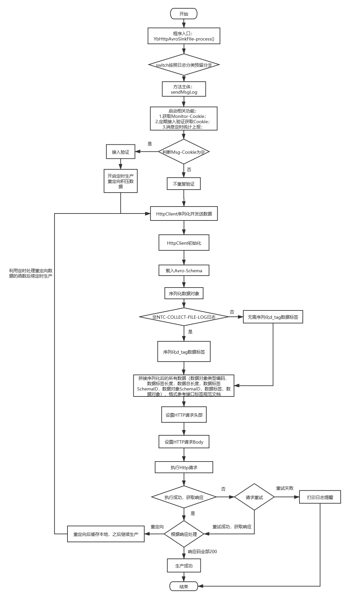
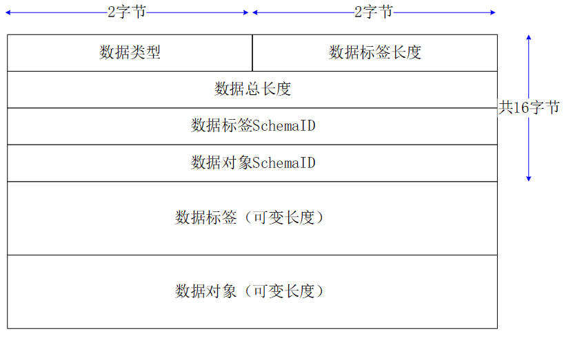

# **总线数据转发**

## Introduction

接收kafka日志,补全后按照总线接口定义的数据结构进行消息生产
- 基于开源flume
- 整合HttpClient


## 代码结构流程图



## 总线单条日志结构




## **安装部署**

**打包** yb_http_avro_sink_file --> maven --> package

**部署**

- 更新部署

  1. 登录flume所在机器

     到达/home/mesasoft/apache-flume-1.9.0-bin/plugins.d/cusflumejar/lib路径下

     ```
     #进入目录
     cd /home/mesasoft/apache-flume-1.9.0-bin/plugins.d/cusflumejar/lib
     
     #备份旧文件（cus-sink-https-avro-file-log-monitor-yb-debug-开头并且.jar结尾）到上级目录（或者自己创建特定文件夹保存旧版本,但不能存放在lib下）
     #移除旧文件示例,注意按实际修改名称
     mv cus-sink-https-avro-file-log-monitor-yb-debug-1.2.200904.jar ../
     
     #上传打好的包yb_http_avro_sink_file-1.0-SNAPSHOT.jar到/home/mesasoft/apache-flume-1.9.0-bin/plugins.d/cusflumejar/lib下，修改打包后包文件名称
     mv yb_http_avro_sink_file-1.0-SNAPSHOT.jar cus-sink-https-avro-file-log-monitor-yb-debug-1.版本数字.日期.jar
     #示例指令,按照实际需求修改
     mv yb_http_avro_sink_file-1.0-SNAPSHOT.jar cus-sink-https-avro-file-log-monitor-yb-debug-1.3.101021.jar
     
     #回到/home/mesasoft/apache-flume-1.9.0-bin路径下
     #先停止所有程序
     ./stop_all.sh
     #再启动所有程序
     ./clean_start_all.sh 进程数 进程起始端口号
     #启动指令示例,进程数根据实际需要修改,需要结合kafka分区数考虑
     ./clean_start_all.sh 1 50000
     ```

